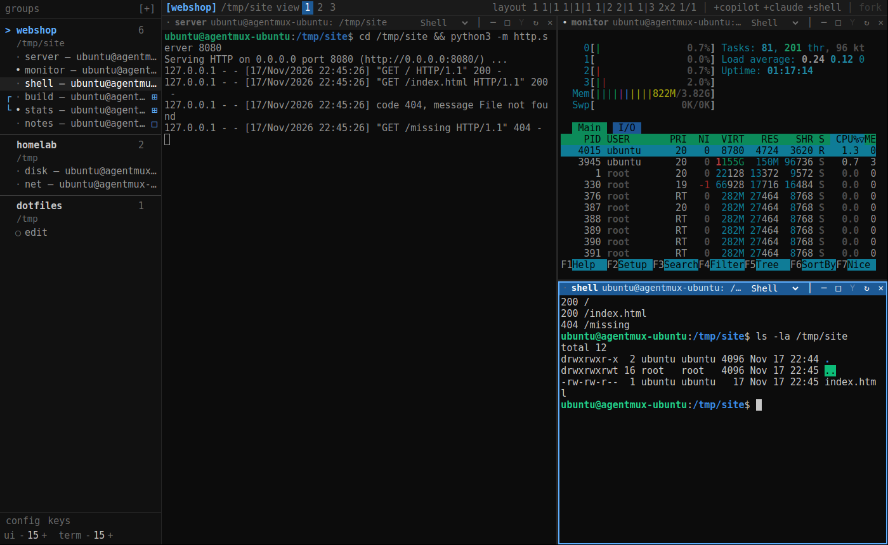
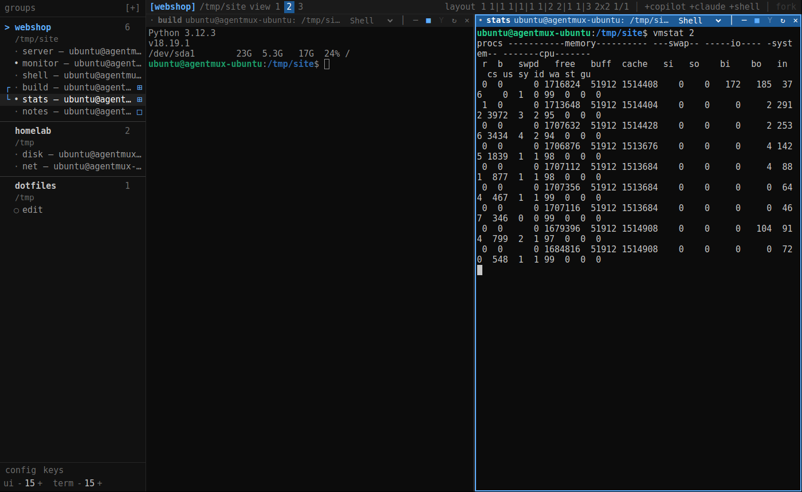
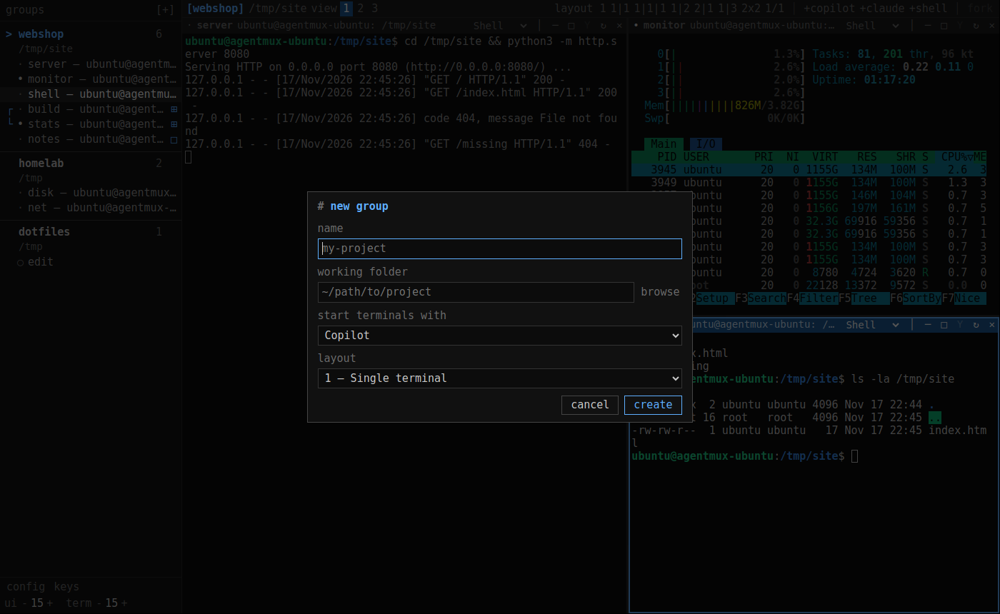
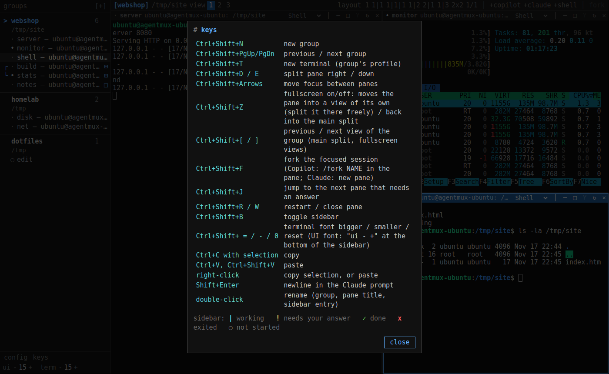

# AgentMux

A small tmux-style terminal multiplexer for **Linux (Ubuntu) and Windows**, made for running several
GitHub Copilot CLI / Claude Code sessions side by side. Copilot is the default profile and runs as
`copilot --yolo` (auto mode: no confirmation for every command).

## What it is

When you work with AI coding agents you end up with many terminals: an agent per project or task, a dev server,
logs, a shell to try things. AgentMux keeps them in one window:

- one **group** per project (its own working folder and default agent), listed in the sidebar;
- inside a group, terminals in **split layouts**, plus **fullscreen views** for the ones you want to see alone;
- the sidebar shows **what every agent is doing**: working, waiting for your answer, or finished. You see at a
  glance which session needs you, get a notification when one asks something, and jump to it with one key;
- everything (groups, layouts, names, fonts) is saved and comes back after a restart, and Claude sessions resume
  their conversation.

It's a desktop app (Electron) with real terminals, so any CLI works in it: `copilot`, `claude`, `htop`, `vim`, ssh,
dev servers, etc.

## Screenshots

A group with three terminals in its main split (dev server, `htop`, a shell). The sidebar lists every group and
terminal; the focused pane has the blue header and frame.



The same group's fullscreen view 2, split into two panes on its own: the main split above stays untouched.
In the sidebar the panes of this view are bracketed `┌ └` and marked `⊞`; `notes` is a lone fullscreen pane (`□`).
The toolbar's `view 1 2 3` switches between them.



New group: name, working folder, the agent its terminals start with, and the starting layout.



Keyboard shortcuts (`keys` at the bottom of the sidebar).



The screenshots were taken on an Ubuntu 24.04 VM with plain shell terminals, so they don't show the agent status
(spinner / `!` / `✓`), the "needs your answer" notifications or fork.

## Features

- **Groups** in the left sidebar (one per project/folder), each with its own terminals.
- **Split layouts** per group: presets (`1`, `1|1`, `1|1|1`, `1|2`, `2|1`, `1|3`, `2x2`, `1/1`) or custom
  splits (split right / down on any pane, drag the dividers).
- **Fullscreen panes get their own view** (`□`, Ctrl+Shift+Z): the pane leaves the main split and is shown alone;
  split it there (`│` / `─` / presets) and those panes stay in that view, the main split is never touched.
  `■` puts a pane back into the main split. Switch views with `view 1 2 3` in the toolbar, the sidebar or
  Ctrl+Shift+[ / ]; in the sidebar a lone fullscreen pane is marked `□`, a split view `⊞` with its panes bracketed `┌ │ └`.
- **Agent status** per pane in the sidebar and pane header: `|/-\` spinner = working, blinking `!` + yellow =
  waiting for you to pick / confirm something, green `✓` = finished your request, `x` = exited.
- "Needs your answer" pops a toast bottom-left with the group › pane/session name (and a desktop notification
  when the window isn't focused); clicking it opens that pane. Ctrl+Shift+J jumps to the next pane that's asking.
  Desktop notifications need a notification daemon (GNOME/KDE have one; on XFCE: `sudo apt install xfce4-notifyd`).
- **Fork** (toolbar `fork`, pane `Y`, Ctrl+Shift+F), asks for a name:
  - Copilot: types `/fork <name>` into the session — the pane continues as the new fork, the original session
    stays saved (`/resume` to reopen it);
  - Claude: `claude --resume <id> --fork-session` in a new pane.
- **Font sizes**: `ui - +` (sidebar, toolbar, pane headers) and `term - +` (terminals) at the bottom of the sidebar.
- The focused pane has a blue header and frame; the other panes are dimmed.
- Double-click a pane/group name to rename. Layout, groups, fonts and profiles are saved and restored.
- Claude panes resume their own conversation after an app restart (↻ restart = fresh session).

Real PTYs (node-pty) rendered with xterm.js in Electron. `wwwroot/lib/` bundles
[xterm.js](https://github.com/xtermjs/xterm.js) 5.5.0 and its fit / webgl / unicode11 addons (MIT, © the xterm.js authors).

## Install

Downloads are on the [Releases](https://github.com/araspudic/AgentMux/releases) page.

### Linux

```bash
sudo apt install ./agentmux_1.0.4_amd64.deb   # then run: agentmux  (or from the app menu)
```

The .deb pulls in its libraries and installs an AppArmor profile (`/etc/apparmor.d/agentmux`) so Electron's
sandbox works on Ubuntu 23.10+. `AgentMux-1.0.4.AppImage` is for other distros (needs libfuse2).

### Windows (10 / 11, x64)

- `AgentMux-Setup-1.0.4.exe`: installs for your user only (no admin rights), with a Start-menu shortcut;
  uninstall from Settings › Apps.
- `AgentMux-1.0.4-portable.exe`: a single exe, nothing installed.

The exes aren't code-signed, so Windows SmartScreen may warn the first time ("More info" › "Run anyway").
Terminals run in PowerShell. Install the CLIs you want to use: Copilot CLI (`winget install GitHub.Copilot`
or `npm install -g @github/copilot`), Claude Code (Claude's hooks need Git for Windows, which Claude Code on
Windows requires anyway).

Coming from the old Windows AgentMux (WinForms)? The new one uses the same data folder (`%APPDATA%\AgentMux`):
your groups and panes are taken over, the profiles are converted (backups: `*.winforms-backup`) and fullscreen
panes become fullscreen views.

## Build

Needs Node 18+.

Linux:

```bash
sudo apt install nodejs npm build-essential python3
./build.sh        # -> dist/agentmux_<version>_amd64.deb, dist/AgentMux-<version>.AppImage
```

Windows (node-pty ships prebuilt Windows binaries, no compiler needed):

```powershell
npm install
npm run dist:win  # -> dist\AgentMux-Setup-<version>.exe, dist\AgentMux-<version>-portable.exe
```

If electron-builder fails with "Cannot create symbolic link" (its signing tools contain macOS symlinks), turn on
Windows Developer Mode or run the build once as administrator.

## How agent status works

Claude panes are started with `--settings <config folder>/claude-hooks.json`. Those Claude Code hooks
(prompt submitted, permission/question asked, tool finished, notification, stop) report the state and session id
to AgentMux over a token-protected local socket on 127.0.0.1.

Copilot has no hooks, so AgentMux reads the bottom of its screen while it's drawing:

1. **needs your answer** only for a prompt that blocks Copilot until you answer, recognised by what Copilot CLI
   draws at the bottom of the screen (tested live with Copilot CLI 1.0.113):
   - the question form: `Copilot needs information.` … `enter accept · ctrl+d decline · esc cancel`
     (free-text questions and pick-one lists);
   - permission / folder-trust menus: `Do you want to allow this?` `❯ 1. Yes …` `↑/↓ to navigate · enter to select`;
   - a numbered menu with a cursor at the very bottom, or a `(y/n)` prompt on the last lines.

   It has to stay on screen for half a second. Menus you open yourself (`/model`, the `/` command list, …) don't
   count, nor do warnings, numbered lists in answers or "Do you want me to …?" sentences;
2. the busy line (`◎ Working ctrl+c interrupt`) → **working**, until it's gone → **done**;
3. otherwise output activity: a burst of output after you sent something → working, output stops → **done**.

Pressing Esc on a pane that shows `!` clears it (and that prompt is ignored until it leaves the screen).
`AGENTMUX_DEBUG=1 agentmux` prints every status change to the terminal (Linux).

## Config

Config and state live in `~/.config/AgentMux/` (Linux) or `%APPDATA%\AgentMux\` (Windows): `config` button in
the sidebar; restart the app to apply.

- Linux: profiles run as `$SHELL -lc "<command>"`, e.g. `"claude; exec \"$SHELL\" -l"` — you're left in a shell
  in the same folder when the CLI exits.
- Windows: profiles run as `<shell> -NoExit -Command <command>` (`"shell": "powershell.exe"` by default,
  `"pwsh.exe"` or `"cmd.exe"` work too), e.g. `"copilot --yolo"`; an empty command is just the shell.

`"gpu": "auto"` (default) turns off GPU rendering when there's no GPU (VMs, remote desktop): Chromium's software
GPU emulation costs a lot of CPU there. Use `"on"` / `"off"` to force it.

## Keys

| Keys | Action |
| --- | --- |
| Ctrl+Shift+N | New group |
| Ctrl+Shift+PgUp / PgDn | Previous / next group |
| Ctrl+Shift+T | New terminal with the group's profile |
| Ctrl+Shift+D / E | Split pane right / down |
| Ctrl+Shift+Arrows | Move focus |
| Ctrl+Shift+Z | Fullscreen pane (own view) / back into the main split |
| Ctrl+Shift+[ / ] | Previous / next view |
| Ctrl+Shift+F | Fork focused session |
| Ctrl+Shift+J | Jump to the pane that needs an answer |
| Ctrl+Shift+R / W | Restart / close pane |
| Ctrl+Shift+B | Toggle sidebar |
| Ctrl+Shift+ = / - / 0 | Font size |
| Ctrl+C with selection, right-click | Copy |
| Ctrl+V, Ctrl+Shift+V, right-click | Paste |
| Shift+Enter | Newline in the Claude prompt |
